final-year cs & ai at newton school of technology. previously sde intern at transient ai (new york) and at [zuvees](https://zuvees.ae) (dubai), where i was one of the first three engineers. first author at ieee appeec 2026.

[website](https://muralimadhav.com) · [linkedin](https://www.linkedin.com/in/c-murali-madhav-2516602aa/) · [email](mailto:cmurali.m23csai@nst.rishihood.edu.in)

### things i've built

**[SIEVE](https://github.com/HackHeroic/sieve)** · cuda, python\
finds patterns in time series without fooling itself. on pure noise: 4% false discoveries, vs 100% for the standard method. on 36 years of vix, with zero finance knowledge, its top rule was volatility clustering. the kernels run 112x faster than single-core numpy; the profiler says the gpu was never the bottleneck.

**[KAT-PatchTST](https://drive.google.com/file/d/11kkBXDHZNQpR5bB-Vir0e4JbweyfZ98j/view?usp=drive_link)** · pytorch · ieee appeec 2026, first author\
a grid forecaster that gets penalized for inventing electricity (a kirchhoff conservation term). 3.65% mape on six us regions. the follow-up beats us grid operators' own day-ahead forecasts: 2.50% vs 3.51%.

**[Snake_game_os](https://github.com/HackHeroic/Snake_game_os)** · c · with [ravi yadav](https://github.com/RAVIYADAV6522)\
terminal snake whose game logic never calls libc's malloc, string.h or math.h. it runs on our own 64 kb first-fit, coalescing allocator. the snake was the easy part.

**[Jarvis](https://github.com/HackHeroic/Jarvis-Engine)** · fastapi, or-tools\
an llm figures out what i meant; a cp-sat solver decides when i'll actually do it. 1st at nst startup foundry 2026.

**[Optiforge](https://github.com/HackHeroic/optiforge)** · tensorflow, streamlit · with ravi yadav and abhijeet k. shah\
lstm and mlp option pricers on 158k real aapl option quotes, r² 0.948 on held-out data. not financial advice.

### elsewhere

- hackmit puzzle contest: 17th worldwide in 2025, 8th in 2026. something is wrong with me.
- google big code 2026, top 50 national finalist · ieeextreme 18.0, 775th of 5,801 teams · jee advanced 2023, air 5,649
- y combinator startup school india 2026 · co-founder of [more than me](https://www.morethanme.in/about), a student initiative for education and healthcare

no stat cards were harmed in the making of this readme.
