final-year cs & ai at newton school of technology. previously sde intern at transient ai (new york) and one of the first three engineers at [zuvees](https://zuvees.ae) (dubai). first author at ieee appeec 2026.

**currently:** looking for swe internships. i come pre-profiled.

[website](https://muralimadhav.com) · [linkedin](https://www.linkedin.com/in/c-murali-madhav-2516602aa/) · [email](mailto:cmurali.m23csai@nst.rishihood.edu.in)

### things i've built

<table>
<tr>
<td width="50%" valign="top">
<b><a href="https://github.com/HackHeroic/sieve">SIEVE</a></b> cuda · python 
pattern mining for noisy time series that doesn't fool itself.  
<b>4%</b> false alarms on pure noise; the standard method: <b>100%</b>. kernels <b>112x</b> faster than single-core numpy.  
<i>given 36 years of vix and zero finance knowledge, it rediscovered volatility clustering.</i>
</td>
<td width="50%" valign="top">
<b><a href="https://drive.google.com/file/d/11kkBXDHZNQpR5bB-Vir0e4JbweyfZ98j/view?usp=drive_link">KAT-PatchTST</a></b> pytorch · ieee appeec 2026 
power-grid forecasting that gets penalized for inventing electricity.  
<b>3.65%</b> mape on six us regions. the follow-up beats grid operators' own forecasts: <b>2.50%</b> vs <b>3.51%</b>.  
<i>first author. kirchhoff is not a co-author, but he should be.</i>
</td>
</tr>
<tr>
<td width="50%" valign="top">
<b><a href="https://github.com/HackHeroic/Snake_game_os">Snake_game_os</a></b> c · with <a href="https://github.com/RAVIYADAV6522">ravi yadav</a> 
terminal snake whose game logic never touches libc's malloc, string.h or math.h.  
runs on our own <b>64 kb</b> first-fit, coalescing allocator.  
<i>the snake was the easy part.</i>
</td>
<td width="50%" valign="top">
<b><a href="https://github.com/HackHeroic/Jarvis-Engine">Jarvis</a></b> fastapi · or-tools 
an ai planner: an llm reads what you meant, a cp-sat solver builds the schedule.  
<b>1st</b> at nst startup foundry 2026.  
<i>it can schedule my week optimally. it cannot make me follow it.</i>
</td>
</tr>
<tr>
<td width="50%" valign="top">
<b><a href="https://github.com/HackHeroic/optiforge">Optiforge</a></b> tensorflow · streamlit · team of 3 
lstm and mlp option pricers, benchmarked live against black-scholes.  
<b>r² 0.948</b> on held-out quotes, from <b>158k</b> real aapl options.  
<i>not financial advice. black-scholes still fits on a napkin.</i>
</td>
<td width="50%" valign="top">
<b><a href="https://github.com/HackHeroic/file_organizer">file_organizer</a></b> c · next.js · with ravi yadav 
a file manager on raw os syscalls, with an ai agent on top.  
<b>mkdir, readdir, rename, unlink, stat</b> in c; natural-language commands and semantic search in the ui.  
<i>the agent asks before it deletes anything, which is more than rm -rf ever did.</i>
</td>
</tr>
</table>

### elsewhere

- hackmit puzzle contest: **17th** worldwide in 2025, **8th** in 2026. something is wrong with me.
- jee advanced 2023: air **5,649** of 180,372. the denominator is doing a lot of work.
- google big code 2026, top 50 national finalist · ieeextreme 18.0, 775th of 5,801 teams
- y combinator startup school india 2026 · co-founder of [more than me](https://www.morethanme.in/about), a student initiative for education and healthcare

no stat cards were harmed in the making of this readme.
